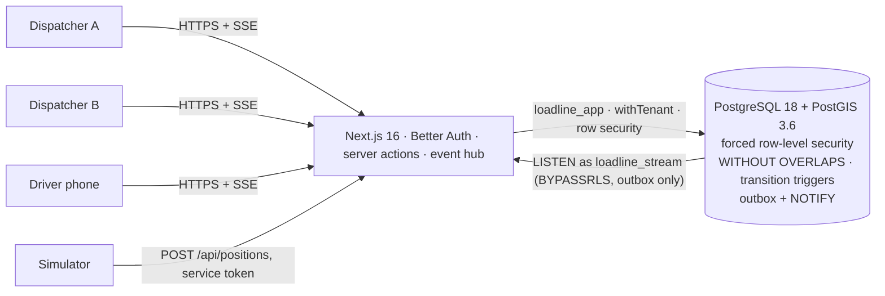

# Loadline

Loadline is a dispatch board for small US trucking companies: the loads, the drivers, the trucks and the map, with every dispatcher's screen updated the moment any of them changes something. It is built for a company with a handful of dispatchers and a few dozen trucks, and it is a portfolio project: everything runs locally with `docker compose up`, all data is synthetic, and the numbers below were measured by scripts in this repository.


The tests run against a real PostgreSQL: tenant isolation under every role, the overlap constraints under concurrent writers, the status transitions, the event cursor and replay, the live hub, positions and arrival, the intake extractors, and two-browser Playwright flows on desktop and phone.


*Left: dispatcher A drags a load to Assigned and picks a driver and truck. Right: dispatcher B's board follows without a refresh. Then the map, with a truck driving toward its next stop.*

## Results

All three tables are generated from `bench/results/*.json` by `pnpm --filter bench readme`; nothing in them is typed by hand. They were measured on a laptop (the machine is named under each table), which is not a server: treat them as the shape of the system, not a capacity claim.

### Sync latency

How long after a write's HTTP response each connected browser has the event.

<!-- bench:sync-latency:start -->
| Clients | Writes | Rate | p50 | p95 | p99 | max | Lost |
| --- | --- | --- | --- | --- | --- | --- | --- |
| 50 | 200 | 4.97/s | 2.5 ms | 4.4 ms | 7.4 ms | 31.5 ms | 0 of 10000 |

Measured 2026-11-11 on Apple M2 Pro (10 cores, 16 GB), one machine, one clock: from the write's HTTP response to each client's SSE receipt.
<!-- bench:sync-latency:end -->

Events travel through a transactional outbox and `NOTIFY`. `NOTIFY` takes a global lock at commit, which starts to hurt at tens of thousands of simultaneous writers ([Recall.ai traced outages to it](https://recall.ai/blog/postgres-listen-notify-does-not-scale)); a dispatch office with a few dispatchers writing a few times a second is far below that, and the measured rate above is where this build was exercised. [Decision 0012](docs/decisions/0012-outbox-and-notify-over-a-broker.md) says what to move to and when.

### Geospatial

The assign dialog's nearest-free-trucks query on a benchmark database, with and without the GiST index, as the app role with row security on.

<!-- bench:geo:start -->
| Query | Runs as | With GiST index | Without index |
| --- | --- | --- | --- |
| Five nearest free trucks for a load (`ORDER BY location <-> $pickup LIMIT 5`) | `loadline_app`, row security on | 0.805 ms (Index Scan on truck_positions_location_idx) | 49.587 ms (Sort over Seq Scan on truck_positions) |
| Open stops within one mile of a point (`ST_DWithin`) | `loadline_app`, row security on | 322.879 ms (Seq Scan on stops) | 326.973 ms (Seq Scan on stops) |
| The same radius query with row security bypassed | superuser | 0.123 ms (Index Scan on stops_location_idx) | 125.828 ms (Seq Scan on stops) |

100,000 trucks and 200,000 stops in a separate benchmark database, median of 20 runs after warm-up, `EXPLAIN (ANALYZE, BUFFERS)`, measured 2026-11-11 on Apple M2 Pro. The first row is the query the assign dialog runs. The second shows that under row security a PostGIS condition cannot use the index, because PostGIS functions are not `LEAKPROOF`; the third is the same query without row security, for scale. The app does no radius sweeps: its arrival check reads one stop by id. See [decision 0018](docs/decisions/0018-geospatial-queries-under-row-security.md).
<!-- bench:geo:end -->

### Intake accuracy

Paste a rate confirmation, get a pre-filled load. Two extractors share one schema: a regex baseline that needs no key, and a Claude extractor that this build never called.

<!-- bench:intake:start -->
| Extractor | Field accuracy | Whole-document accuracy | Cost / doc | Latency p50 |
| --- | --- | --- | --- | --- |
| Regex baseline | 85.6% | 38.3% | $0 | — |
| Claude (claude-haiku-5-5) | not yet measured | not yet measured | not yet measured | not yet measured |

60 synthetic rate confirmations, exact match per field after normalisation, measured 2026-11-11. The baseline's patterns were tuned on these same documents, so its score is an upper bound for these layouts, not a general figure. Claude's row is filled in by `pnpm eval:intake --extractor claude --live`, which needs an API key and was not run in this build.
<!-- bench:intake:end -->

## Quick start

You need Docker, and on Apple Silicon one extra `docker build` (below).

```sh
git clone <this repository> loadline && cd loadline
cp .env.example .env
docker compose up
```

Then open <http://localhost:3000>. The first start builds the web and simulator images, creates the database roles, runs the migrations and seeds two companies.

| Company | Logins | Password |
| --- | --- | --- |
| Acme Freight (Dallas, TX) | `owner@acme-freight.example`, `admin@acme-freight.example`, `dispatch1@acme-freight.example`, `dispatch2@acme-freight.example`, `driver1@acme-freight.example` … `driver8@acme-freight.example` | `loadline-demo` |
| Blue Ridge Haulers (Charlotte, NC) | the same names at `@blueridge-haulers.example` | `loadline-demo` |

Sign in as both dispatchers in two browser windows to see the board follow itself. A driver login shows the phone page for that driver's loads. The simulator moves the trucks of assigned and in-transit loads toward their next stop at sixty times real speed and reports them every three seconds.

Two notes for local machines:

- **Apple Silicon.** The official `postgis/postgis:18-3.6` image is amd64 only and PostGIS under emulation is slow enough to distort the benchmark. Build a native image once with `docker build --platform linux/arm64 -t loadline/postgis:18-3.6 docker/postgis` (or `pnpm db:image`) and set `POSTGIS_IMAGE=loadline/postgis:18-3.6` in `.env` ([decision 0001](docs/decisions/0001-postgis-image-on-apple-silicon.md)).
- **A PostgreSQL already on 5432.** Change `DB_PORT` and the five `DATABASE_URL_*` values in `.env` together.

To develop outside Docker: `pnpm install`, `pnpm db:up`, `pnpm db:setup`, `pnpm dev`. `pnpm test` runs every suite against the test database (`pnpm db:test:up`), `pnpm e2e` runs the Playwright flows, `pnpm bench:sync` and `pnpm bench:geo` reproduce the tables, and `pnpm eval:intake` scores the baseline.

## How it works



- **One database, four database roles.** `loadline_owner` owns the schema and runs migrations, `loadline_app` serves every request, `loadline_auth` sees only the auth schema, and `loadline_stream` can read the outbox and nothing else. The schema is hand-written SQL in [`packages/db/migrations`](packages/db/migrations); the app has a Drizzle mirror that a test keeps in step ([0008](docs/decisions/0008-sql-migrations-and-drizzle-mirror.md)).
- **Rules live in the database.** Row-level security is forced on every tenant table and applies to the owner too ([0003](docs/decisions/0003-row-level-security-over-filters.md), [0009](docs/decisions/0009-policies-apply-to-the-owner.md)). A driver's rights are a second, restrictive layer of policies. Double-booking is impossible by constraint, not by check ([0004](docs/decisions/0004-temporal-constraints-over-application-check.md)). Status changes go through a trigger that knows the allowed transitions.
- **Every query runs inside `withTenant`.** It opens a transaction, sets the company, role and user for the policies, and hands the caller a transaction handle. A lint rule and a scanning test keep the raw pool out of the app ([`packages/db/src/with-tenant.ts`](packages/db/src/with-tenant.ts)).
- **Every mutation leaves an event.** Writes call `app.emit()` in the same transaction; the hub reads the outbox with a visibility-safe cursor and fans events out over server-sent events, scoped by company and, for drivers, by audience ([0012](docs/decisions/0012-outbox-and-notify-over-a-broker.md), [0013](docs/decisions/0013-visibility-safe-cursor.md), [0014](docs/decisions/0014-server-sent-events-over-websockets.md), [0005](docs/decisions/0005-stream-role-with-bypassrls.md)).
- **Positions and arrival** are one function, `app.record_position()`, which also marks a stop arrived when the truck is inside the company's radius ([0016](docs/decisions/0016-positions-arrival-and-the-simulator.md), [0018](docs/decisions/0018-geospatial-queries-under-row-security.md)).
- **Intake** is a separate package with one schema, two extractors and an eval ([0017](docs/decisions/0017-load-intake.md)).
- **Auth and roles** come from Better Auth with an organization per company and four roles ([0011](docs/decisions/0011-auth-and-app-shell.md), [0010](docs/decisions/0010-system-role.md)). Rate limits and headers: [0019](docs/decisions/0019-rate-limits-and-response-headers.md). Self-hosting: [0015](docs/decisions/0015-self-hosting-over-serverless.md). Time zones: [0006](docs/decisions/0006-state-to-time-zone-approximation.md). The city table: [0007](docs/decisions/0007-city-table-source.md).

The full list is in [`docs/decisions`](docs/decisions/README.md).

## Why it is built this way

**Why row-level security instead of a `WHERE` clause in every query?** Because a `WHERE` clause is a habit and a policy is a rule: the one query somebody forgets is the one that leaks a competitor's loads. Every tenant table has `ENABLE` and `FORCE ROW LEVEL SECURITY` with a policy on `company_id` ([`0003_rls.sql`](packages/db/migrations/0003_rls.sql)), the app role has no way around it, and the isolation tests ([`isolation.test.ts`](packages/db/test/db/isolation.test.ts)) read, update and delete every tenant table from the wrong company as the app role and expect nothing back, then check what each role may do within its own company. What a driver may write is a trigger, not a convention ([`0010_driver_writes.sql`](packages/db/migrations/0010_driver_writes.sql)).

**Two dispatchers assign the same load in the same second; what happens?** One of them wins and the other sees a conflict, not a double booking. The assignment row carries the driver, the truck and a time range, and three `WITHOUT OVERLAPS` constraints in [`0001_schema.sql`](packages/db/migrations/0001_schema.sql) (per driver, per truck, per load) make the second insert wait on the first transaction and fail the moment it commits, whatever order the requests arrive in; the load's `version` column catches the slower case where the second dispatcher acted on a board that had not yet heard about the first. The loser's screen rolls back its optimistic move and shows who got it ([`assignLoad`](apps/web/src/server/loads.ts), [`services.test.ts`](apps/web/test/db/services.test.ts) runs the race).

**What does a browser miss while it is offline, and how does it catch up?** Nothing, for as long as the outbox keeps events (24 hours). Each event frame carries a cursor that is safe to resume from: a transaction id and a row id, never just the row id, because identities are handed out before commit and a plain `id > last` skips rows ([`0013`](docs/decisions/0013-visibility-safe-cursor.md), [`stream.ts`](packages/db/src/stream.ts)). The browser reconnects with `Last-Event-ID`, the hub replays from there under the same lock that delivers new rows ([`hub.ts`](apps/web/src/server/stream/hub.ts)), and a client whose cursor is older than the oldest kept event is told to reload instead of being fed a gap ([`cursor.test.ts`](packages/db/test/db/cursor.test.ts), [`hub.test.ts`](apps/web/test/db/hub.test.ts)).

**`NOTIFY` takes a global lock at commit; when does that start to hurt, and what would you move to?** It hurts when many transactions that each sent a `NOTIFY` commit at once, because they serialise on that lock; at tens of thousands of writers it has caused outages. Here `NOTIFY` only wakes the reader and carries no payload, so the first move is to drop it for a short poll of the outbox ([`OutboxReader`](packages/db/src/stream.ts)), which changes nothing else; the second, when one web process is not enough, is logical replication of the outbox into a broker, with the same cursor ([`0012`](docs/decisions/0012-outbox-and-notify-over-a-broker.md)).

**How do you know the intake is good enough to trust?** By measuring it on documents with known answers and showing the dispatcher what it could not read. Sixty synthetic rate confirmations with expected JSON live in [`packages/intake/fixtures`](packages/intake/fixtures), eight of them carrying prompt-injection attempts; `pnpm eval:intake` scores an extractor field by field and writes the result file the table above is generated from ([`score.ts`](packages/intake/src/eval/score.ts)). The baseline's score is an upper bound for layouts it was tuned on, Claude's is not yet measured, and in either case the form shows every field for review with warnings on the ones it had to guess; nothing is saved until a dispatcher clicks Create.

## Limits

- **Distances are straight lines** (great-circle), not road miles or drive times.
- **Places come from a table of about a thousand US cities**, not a geocoder; the intake picks from that table and says when it cannot.
- **`NOTIFY` holds a global lock at commit**; see the sync latency section for when that matters and what replaces it.
- **Fan-out runs in one web process.** A second process would read the same outbox and serve its own clients, but nothing here coordinates two of them, and the rate limiter counts per process ([0019](docs/decisions/0019-rate-limits-and-response-headers.md)).
- **No hours-of-service rules.** A driver can be assigned any load whose window does not overlap another; nothing checks legal driving limits.
- **No member management yet.** Logins, roles and the link between a driver row and a login come from the seed; there is no invitation screen and no way to add a login from the app in 0.1.
- **Intake is measured on synthetic documents only**, written for this project; real rate confirmations are messier, and the Claude extractor has not been run at all in this build.
- **Under row security, PostGIS conditions cannot use the index** ([0018](docs/decisions/0018-geospatial-queries-under-row-security.md), the second row of the geo table); the product's only radius test is a single-row lookup, so this costs nothing today, but a feature such as "all stops near this truck" would need a different approach.

## How this was built

Claude Code built this in one unattended run through six phases, with a fresh-context reviewer at the end of each phase briefed to break tenant isolation, the overlap constraints and the event replay. [`docs/building-with-ai.md`](docs/building-with-ai.md) keeps, per phase, what Claude wrote, what its reviewer caught, and where it was wrong. Some of the places it was wrong:

- The first event reader took the spec's visibility rule literally and stalled every board whenever any transaction in the cluster stayed open; the two-browser tests showed it within an hour, and the fix (deliver committed rows at once, resume from the safe horizon) is the design that shipped.
- The geospatial benchmark first measured the index as a superuser with a literal point and looked great. Run as the app role under row security, the same query did not use the index at all; the query's shape changed and the table above is the honest version.
- The intake wrapper's closing tag could be forged by pasted text; the reviewer rated it high, and the tag name now carries the nonce.
- The regex baseline obeyed one of its own injection fixtures ("the carrier pays $0") until the injection test caught it.

What was verified rather than trusted: every database rule has a test against a real PostgreSQL under the role it binds; the hub's replay guarantees have tests that open and commit transactions out of order; the two-browser flows run in Playwright on desktop and phone; and every number in this README comes from a committed results file.

<!-- TODO(Harun): two sentences on what you saw go wrong in three years of dispatch and which feature here answers it. Claude Code does not write this paragraph. -->

> **TODO(Harun)** — _Two sentences on what went wrong in three years of dispatch, and which feature answers it._

## License

MIT. All company names, people, documents and numbers in the seed and the fixtures are invented.
